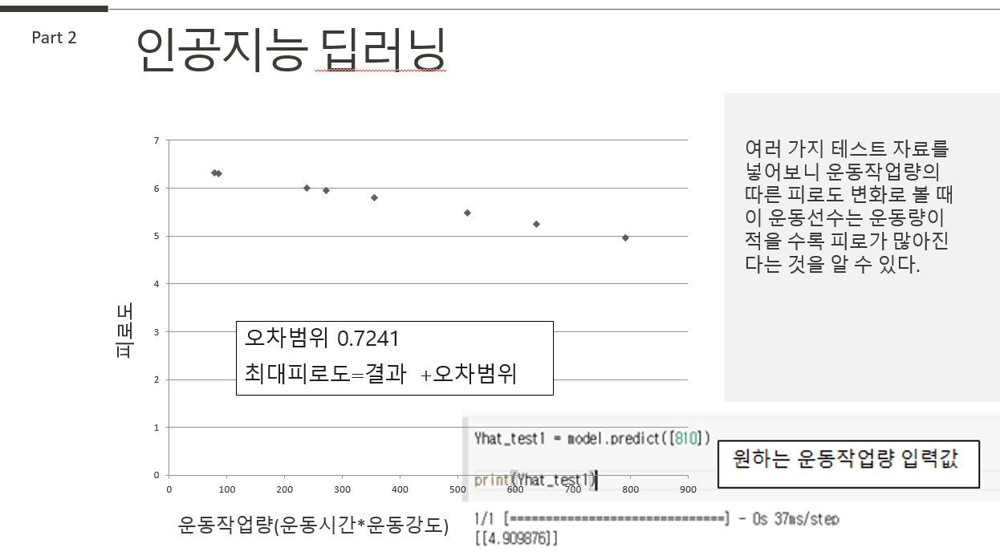

# 운동작업량 기반 피로도 예측 AI

> 2022 전남대학교 인공지능 활용 해커톤 **최우수상** (2022.11.26) · 동신대학교 컴퓨터공학과 박민수

운동선수의 **운동작업량(운동강도 × 운동시간)** 을 입력하면 **피로도**를 예측하는 신경망 회귀 모델입니다.

## 문제 정의

피로가 쌓이면 요구되는 운동 강도를 유지할 수 없고, 결국 훈련을 쉬게 됩니다.
운동작업량에 따른 피로도를 미리 예측할 수 있다면 훈련량을 조절해 이를 예방할 수 있지 않을까 하는 생각에서 시작했습니다.

## 접근 방법

1. **변수 통제:** 기분 · 스트레스도 피로도에 영향을 주므로, 한 선수(18164번)의 데이터 중 기분 · 스트레스 수치가 비슷한 날짜 8일치만 골랐습니다.
2. **입력 정의:** 운동작업량 = 운동강도 × 운동시간
3. **모델:** Keras `Sequential` — `Dense(5, input_dim=1)` → `Dense(1)`
4. **학습:** 손실 함수 MSE, 옵티마이저 Adam, 1,000 epoch
5. **예측:** 새 운동작업량(예: 810)을 넣어 예상 피로도를 계산

| 입력(X) 운동작업량 | 792 | 240 | 272 | 637 | 80 | 86 | 518 | 356 |
|---|---|---|---|---|---|---|---|---|
| 정답(Y) 피로도 | 5 | 7 | 7 | 4 | 5 | 6 | 6 | 6 |

## 결과

- 학습 오차(MSE): **0.7241**
- 이 선수는 운동작업량이 늘수록 예측 피로도가 낮아지는 경향을 보였습니다.

## 한계와 다시 한다면 (2026 회고)

- **데이터가 8개뿐**이라 일반화하기 어렵습니다. 더 많은 날짜와 선수 데이터가 필요합니다.
- 은닉층에 **활성화 함수가 없어** 실제로는 직선 하나를 맞추는 **선형 회귀와 같은 모델**입니다. 비선형 관계를 배우려면 `activation='relu'` 같은 활성화 함수가 필요합니다.
- 학습 데이터로만 오차를 쟀습니다. 검증용 데이터를 따로 나눠 평가해야 합니다.
- 기분 · 스트레스를 "통제"로만 썼는데, 다음에는 입력 변수로 함께 넣는 다변수 모델로 비교해 보고 싶습니다.
- 노트북 끝의 그래프 그리기 코드(`plt.subplot`)는 당시 작성하다 멈춘 부분이라 그대로 실행하면 오류가 납니다. 원본 기록으로 남겨 두었습니다.

## 실행

Google Colab에서 `fatigue_prediction.ipynb`를 열고 위에서부터 실행합니다. (Keras/TensorFlow 기본 설치 환경)
